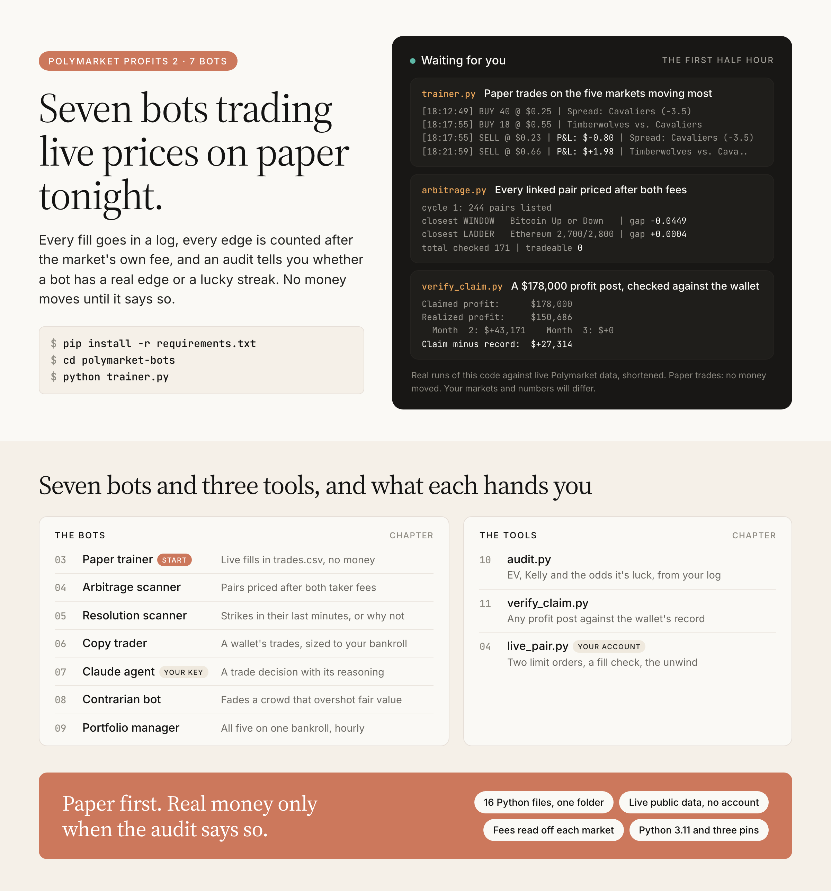

# Polymarket Profits 2: the seven bots

**Seven Polymarket paper-trading bots. They run on your laptop against live prices, log every fill, and an audit script tells you if the profit was skill or luck.**

Companion code to the book *Polymarket Profits 2 - Build 7 Trading Bots This Weekend*, from [youcanbuildthings.com](https://youcanbuildthings.com).

Small Python programs that watch real Polymarket prices and write down the trades they would make, with no money spent. Two terms come up fast: *paper trading* (pretend fills at real prices, set up in [chapter 3](chapters/03-paper-trainer)) and *taker fee* (what Polymarket charges per trade, in [chapter 2](chapters/02-live-data)). Pick your line under Start here.

[](https://github.com/regardo911/polymarket-profits-2/actions/workflows/ci.yml) [](LICENSE) 

> Paper mode, public data, no key, no account. Educational software, not financial advice: read [DISCLAIMER.md](DISCLAIMER.md) before any money moves. Unofficial, not affiliated with Polymarket.

## Start here

**"Show me a bot trading right now."** You need Python 3.11 or newer: `python3 --version`. The Python that ships with macOS is 3.9, and on it the install stops at `No matching distribution found for requests==2.34.2`; get 3.11+ from python.org and use `python3.11` in the venv line.

```bash
git clone https://github.com/regardo911/polymarket-profits-2.git
cd polymarket-profits-2
python3 -m venv .venv
source .venv/bin/activate            # Windows: .venv\Scripts\activate
pip install -r requirements.txt
cd polymarket-bots
python trainer.py
```

The trainer picks the five busiest markets that are moving, paper-trades them every minute, and appends every fill to `trades.csv`. From a real run (paper fills, no money moved):

```
[18:12:49] BUY 40 @ $0.25 | Spread: Cavaliers (-3.5)
[18:17:55] BUY 18 @ $0.55 | Timberwolves vs. Cavaliers
[18:17:55] SELL @ $0.23 | P&L: $-0.80 | Spread: Cavaliers (-3.5)
[18:21:59] SELL @ $0.66 | P&L: $+1.98 | Timberwolves vs. Cavaliers
```

Leave it 30 minutes, then `python audit.py` reads your log. Quiet markets can take longer to cross the 3% band; restart and it picks the ones moving now.

**"I want to know if that pair is really free money."** `python arbitrage.py` prices every Up/Down window, strike ladder and deadline series after both fees. Zero tradeable is the usual, honest answer. [Chapter 4](chapters/04-arbitrage)

**"Someone posted a profit screenshot with a wallet."** `python verify_claim.py <wallet> <claimed profit>` lays the wallet's own record next to the headline, month by month. [Chapter 11](chapters/11-check-a-claim)

**"I finished the book and want the files."** The copy table is next.

## The copy table

The book builds one folder, `polymarket-bots/`, and every later file imports the earlier ones by name. Copy the whole folder.

| Chapter | In this repo | In your project |
|---|---|---|
| 2 | `polymarket-bots/scanner.py`, `watch.py`, `stream.py` | `polymarket-bots/` |
| 3, 10 | `polymarket-bots/trainer.py` | `polymarket-bots/` |
| 4 | `polymarket-bots/arbitrage.py`, `live_pair.py`, `requirements-live.txt` | `polymarket-bots/` |
| 5 | `polymarket-bots/resolution.py` | `polymarket-bots/` |
| 6 | `polymarket-bots/copy_trader.py`, `copy_start.py` | `polymarket-bots/` |
| 7 | `polymarket-bots/claude_agent.py` | `polymarket-bots/` |
| 8 | `polymarket-bots/contrarian.py` | `polymarket-bots/` |
| 9, 12 | `polymarket-bots/portfolio_manager.py` | `polymarket-bots/` |
| 9 | `chapters/09-run-all-five/polymarket.conf` | `/etc/supervisor/conf.d/` on your server |
| 10, 12 | `polymarket-bots/utils.py`, `audit.py` | `polymarket-bots/` |
| 11 | `polymarket-bots/verify_claim.py` | `polymarket-bots/` |
| Appendix A | `polymarket-bots/config.py`, `requirements.txt` | `polymarket-bots/` |

`trades.csv` and the `*_trades.csv` logs appear the first time a bot trades.

## Chapter map

| Chapter | What you build | Run | It worked when |
|---|---|---|---|
| [2](chapters/02-live-data) | the live data feed | `python scanner.py` | 100 markets fetched, bids and asks with depth |
| [3](chapters/03-paper-trainer) | the paper trainer | `python trainer.py` | BUY and SELL lines, a status block every 10 cycles |
| [4](chapters/04-arbitrage) | the arbitrage scanner, the guarded live pair | `python arbitrage.py` | 1,000+ pairs checked, closest gap per kind |
| [5](chapters/05-resolution) | the resolution scanner | `python resolution.py 240` | SKIP lines with reasons, the redemption check ran |
| [6](chapters/06-copy-trading) | the copy trader | `python copy_start.py --target-wallet 0x...` | 5+ target trades seen, each sized or skipped |
| [7](chapters/07-claude-agent) | the Claude agent | `python claude_agent.py` | reasoning for 3+ markets in `agent_log.jsonl` |
| [8](chapters/08-contrarian) | the contrarian bot | `python contrarian.py` | 3+ overshoots found (needs `NEWS_API_KEY`) |
| [9](chapters/09-run-all-five) | the portfolio manager | `python portfolio_manager.py` | the hourly dashboard, reserve included |
| [10](chapters/10-audit-your-log) | the trade-log audit | `python audit.py` | EV, Kelly and a luck figure from your log |
| [11](chapters/11-check-a-claim) | the claim checker | `python verify_claim.py <wallet> <profit>` | realized vs claimed, month by month |
| [12](chapters/12-monday-report) | the weekly edge report | inside `portfolio_manager.py` | one report: decay and Sharpe, or INSUFFICIENT DATA |

Chapter 1 has no code, just the map of the book. Every bot takes command-line flags for the numbers the book prints, with the book's values as defaults: `python <bot>.py --help`.

## How it fits together



One test rig runs every strategy. `scanner.py` reads the market, `PaperPortfolio` in `trainer.py` keeps the books, and each bot is its own rule for when to call `buy()`. `portfolio_manager.py` gives the five strategies a slice each of one bankroll and keeps 15% in cash. `audit.py` and the Monday report then judge each one by expected value from its own log, before any money moves.

## What it needs

Python 3.11+ and the three pins in `requirements.txt` (`requests`, `websockets`, `anthropic`). Most bots read only Polymarket's free public APIs, so a network connection is all they need. The exceptions are below. The offline test suite (`python -m unittest discover tests`) needs neither network nor keys.

Two pieces run on something of yours:

- `claude_agent.py` runs on your own Anthropic API key and hands back a full decision cycle against live markets: the tool calls, Claude's reasoning, any paper trade, and the cycle's cost from the API's own token counts. Each cycle is billed to your key.
- `live_pair.py` in live mode places two limit orders on your own Polymarket or Polymarket US account, checks both fills, and unwinds a leg that fills alone. As shipped it prints the orders it would send and stops.

`contrarian.py` trades only with a `NEWS_API_KEY`; without one it scans.

## Going live

The chapters' order, and the code's: paper first, for at least 7 days; positive EV after fees over 50+ closed trades (`python audit.py`); then one strategy with $100-200 of real capital, watched for the first 24 hours.

Every live order needs the code-level switch in `live_pair.py`: `set_live_mode(True, confirm="I_HAVE_REVIEWED_THIS")`, uncommented by you after reading the file. No flag or environment variable turns it on. Check `GET https://polymarket.com/api/geoblock` first: polymarket.com is close-only for the United States, so US readers use Polymarket US or Kalshi.

> ⚠ Don't run a bot that asks for your private key unless you've read every line of it. That includes this one.

## Configuration

None is required. Keys come from the environment: `ANTHROPIC_API_KEY` (Chapter 7), `NEWS_API_KEY` (optional), `TARGET_WALLET` (Chapter 6, or pass `--target-wallet`). `config.py` is the Appendix A list of every default; no bot imports it, and each value is also that bot's flag default.

## Contributing

Fixes welcome: [CONTRIBUTING.md](CONTRIBUTING.md). Where the printed book doesn't work as written, and what these files do instead: [BOOK-FIXES.md](BOOK-FIXES.md).

## License

MIT, see [LICENSE](LICENSE).

Educational software, provided as-is. Not financial advice.
